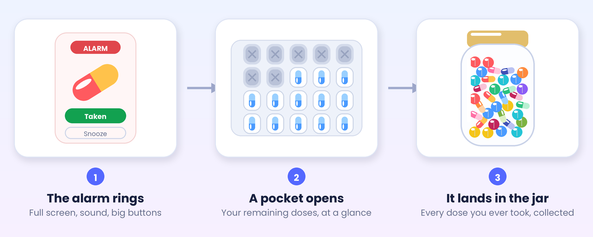
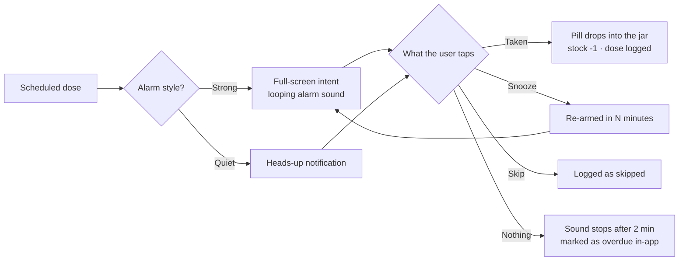
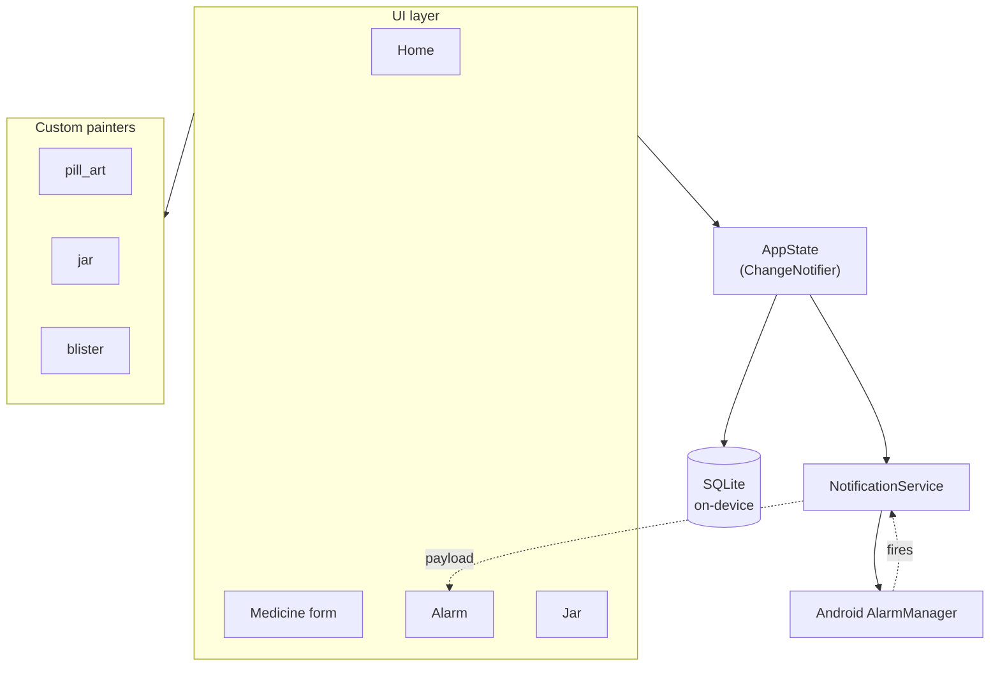
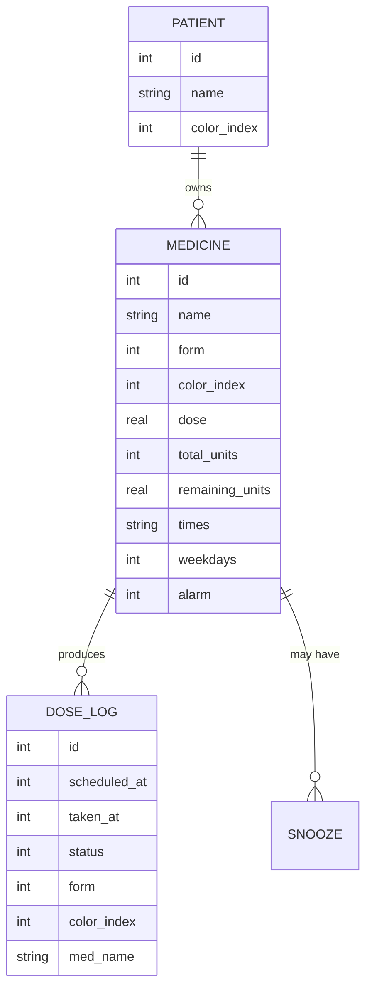

<div align="center">


<h1>Medicine Reminder · دوائي</h1>

<p><b>An offline, Arabic-first medication reminder for Android — built so that a 70-year-old can use it without help.</b></p>

<p>
  
  
  
  
  
</p>

<p>
  <a href="#-what-it-does">What it does</a> ·
  <a href="#-features">Features</a> ·
  <a href="#-quick-start">Quick start</a> ·
  <a href="#-how-a-reminder-actually-fires">How it works</a> ·
  <a href="#-architecture">Architecture</a> ·
  <a href="#-troubleshooting-alarms">Troubleshooting</a>
</p>

**English** · **[العربية](README.ar.md)**

</div>

---

## 💊 What it does

Most pill-reminder apps are a to-do list with a bell on top. This one turns adherence into
something you can **see**: every dose you take drops as a coloured pill into a glass jar that
slowly fills up, and the blister strip for that medicine loses a pocket.



Nothing ever leaves the phone. There is **no account, no server, no analytics, and no network
permission** — the app is usable on a phone that has never seen a SIM card.

---

## ✨ Features

| | Feature | What it means in practice |
|:--:|---|---|
| ⏰ | **Full-screen alarm** | Wakes the screen over the lock screen, loops the alarm-stream sound, vibrates, and auto-stops after 2 minutes so it can never ring forever |
| 🔔 | **Quiet mode** | Per medicine, you can choose a normal heads-up notification instead — same buttons, gentler |
| 👆 | **Act from the notification** | *Taken* and *Snooze* buttons, no need to hunt for the app |
| 🫙 | **The jar** | Every taken dose is stored with its colour and shape and stacks up inside a glass jar, per patient, with monthly filtering and a streak counter |
| 💊 | **Blister strip** | Shows exactly how many doses are left; each dose tears open one pocket with a little pop animation |
| 👨‍👩‍👧 | **Multiple patients** | One phone can look after a whole household — separate medicines, jars, and history |
| 🎨 | **Hand-drawn pills** | Capsules, tablets, syrup bottles, syringes and drops are painted with `CustomPainter`, so there are **zero image assets** and everything animates smoothly |
| 📦 | **Stock tracking** | Quantity decreases automatically, warns when the supply runs low, and has a one-tap refill |
| 🕌 | **Arabic first** | Full RTL UI, Levantine/Iraqi month names, Arabic-Indic numerals (٠١٢٣) that can be switched off |
| 👵 | **Elderly-friendly** | 17–36 px type, 60–80 px buttons, a time picker made of big **+** / **−** steppers instead of a clock dial, and three font-size presets |

<details>
<summary><b>📅 Scheduling options</b> — click to expand</summary>

<br>

- Any number of times per day (e.g. 08:00, 14:00, 22:00)
- Specific weekdays only, or every day
- A start date plus a fixed course length (3 / 5 / 7 / 10 / 14 / 30 / 90 days) or *ongoing*
- Dose amount with a unit: tablet, capsule, spoon, ml, drop, injection, sachet, puff
- Free-text note shown on the alarm screen (e.g. *"straight after food"*)
- Configurable snooze length: 5, 10, 15 or 30 minutes

</details>

<details>
<summary><b>🖥️ The screens</b> — click to expand</summary>

<br>

| Screen | Purpose |
|---|---|
| **Patients** | Pick or add a patient; each gets a colour and an avatar initial |
| **Home** | Next-dose banner, the jar with live stats, today's doses with a big green *Taken* button, and the full medicine list |
| **Add / edit medicine** | Live preview of the pill, form and colour pickers, times, weekdays, course length, stock, alarm style |
| **Medicine detail** | Blister strip, remaining / taken / days-left stats, refill, today's doses, and a jar of just this medicine |
| **Jar** | Full-size jar, month switcher, and a day-by-day history log |
| **Alarm** | Pulsing pill, patient name, dose, note, and three big buttons: *Taken* / *Snooze* / *Skip* |
| **Settings** | Permission health-check, alarm test buttons, snooze length, numerals, font size |

> 📸 Screenshots welcome — drop PNGs into `docs/screenshots/` and link them here.

</details>

---

## 🚀 Quick start

```bash
git clone https://github.com/Thanoon12k/medicine-reminder.git
cd medicine-reminder
flutter pub get
flutter run
```

<details>
<summary><b>📦 Build a release APK</b></summary>

<br>

```bash
flutter build apk --release --split-per-abi
```

Grab `build/app/outputs/flutter-apk/app-arm64-v8a-release.apk` — that's the ~8 MB build for
every modern phone. For a single universal APK, drop `--split-per-abi`.

For the Play Store:

```bash
flutter build appbundle --release
```

> ⚠️ Release builds are currently signed with the **debug key**. They install and run fine
> for personal use, but create your own keystore before publishing and point
> `signingConfig` in `android/app/build.gradle.kts` at it.

</details>

<details>
<summary><b>🧪 Run the tests</b></summary>

<br>

```bash
flutter test
```

Covers Arabic number/date/time formatting and the scheduling rules (weekday masks, course
end dates, stock-to-days maths).

</details>

<details>
<summary><b>🔧 Requirements</b></summary>

<br>

| | Minimum |
|---|---|
| Flutter | 3.38.1 (developed on 3.47) |
| Dart | 3.10 |
| Android | 7.0 / API 24 |
| compileSdk | 36 |
| Java | 17 |

Core-library desugaring is enabled — required by `flutter_local_notifications` for scheduling.

</details>

---

## 🔁 How a reminder actually fires



<details>
<summary><b>⚙️ Why it's built this way</b></summary>

<br>

- **Ten days at a time.** Android caps pending alarms, so the app materialises the next 10 days
  of doses (up to 380 notifications) and rebuilds the whole set whenever a medicine changes,
  a dose is logged, or the app comes back to the foreground.
- **`AndroidScheduleMode.alarmClock`** for strong alarms — the same priority the system clock
  uses, so Doze mode can't defer them. Quiet reminders use `exactAllowWhileIdle`.
- **`FLAG_INSISTENT`** on an alarm-usage notification channel is what makes the sound repeat
  and play through the *alarm* volume slider rather than the notification one.
- **Reboot-safe.** `ScheduledNotificationBootReceiver` re-arms everything after a restart.
- **Timezone without the network.** The IANA database ships inside the `timezone` package;
  the app matches the device's UTC offset against it locally.
- **Snoozes are persisted** in SQLite, so a snoozed dose survives a reboot too.

</details>

---

## 🏗️ Architecture



<details>
<summary><b>📂 Project structure</b></summary>

<br>

```
lib/
├── main.dart                       entry point + notification routing
├── core/
│   ├── palette.dart                app colours & the 12 medicine colours
│   ├── format.dart                 Arabic numerals, dates, times
│   └── theme.dart                  Material 3 theme + gradient background
├── models/models.dart              Patient, Medicine, DoseLog, Snooze
├── data/
│   ├── db.dart                     sqflite schema and queries
│   └── app_state.dart              single source of truth, all mutations
├── services/notifications.dart     channels, scheduling, permissions
├── widgets/
│   ├── pill_art.dart               every pill shape, drawn in code
│   ├── jar.dart                    the glass jar + drop animation
│   ├── blister.dart                blister strip + tear animation
│   └── common.dart                 cards, big buttons, stepper time picker
└── screens/                        7 screens, all RTL Arabic
```

</details>

<details>
<summary><b>🗄️ Data model</b></summary>

<br>



`DOSE_LOG` deliberately **denormalises** the medicine's name, colour and shape. That way the
pills already in your jar keep their identity even if you later delete the medicine.

Scheduled doses are never stored — they are computed on the fly from
`start_date + times + weekdays + duration`. Only what actually happened gets written down.

</details>

---

## 🩹 Troubleshooting alarms

<details open>
<summary><b>The alarm doesn't ring — read this first</b></summary>

<br>

Android is aggressive about killing background alarms. Open **Settings → Enable permissions**
inside the app, then check these on the phone:

| # | Setting | Where |
|---|---|---|
| 1 | Notifications allowed | App info → Notifications |
| 2 | **Alarms & reminders** allowed | App info → Alarms & reminders (Android 12+) |
| 3 | **Battery optimisation → Unrestricted** | App info → Battery |
| 4 | Full-screen notifications allowed | App info → Notifications (Android 14+) |
| 5 | Autostart enabled | Xiaomi / Oppo / Vivo / Huawei security app |

Number 3 is the usual culprit. Xiaomi (MIUI/HyperOS), Huawei, Oppo and Samsung all freeze
apps they consider idle, which silently cancels pending alarms.

The **Test alarm** and **Test notification** buttons in Settings fire immediately — use them
to confirm the sound before relying on the app.

</details>

---

## 🗺️ Roadmap

- [x] Offline scheduling with full-screen alarms
- [x] Jar, blister strip and code-drawn pill art
- [x] Multi-patient support
- [x] Adaptive launcher icon
- [ ] Weekly / monthly adherence report
- [ ] Backup & restore to a local file
- [ ] Caregiver mode (a second phone mirrors the jar)
- [ ] English UI alongside Arabic

---

## 📜 History

This repository previously hosted a Python/Telegram bot version of the same idea. That code
is still in the git history at commit [`ecd18d1`](https://github.com/Thanoon12k/medicine-reminder/commit/ecd18d1)
if you want it — the Flutter app replaces it.

---

## 📄 License

[MIT](LICENSE) © Thanoon Younes

<div align="center">
<br>
<sub>Built with Flutter · No network permission · No account · No tracking</sub>
</div>
